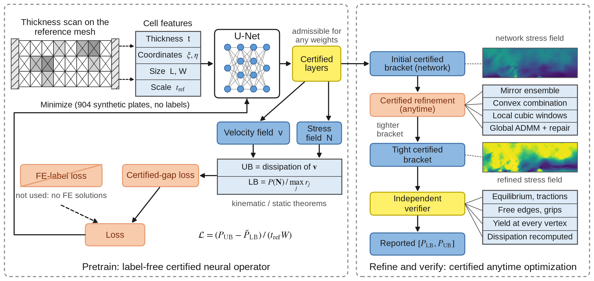

# Certified neural limit analysis

Code for the paper **"Certified neural limit analysis: neural operators with rigorous lower and upper bounds on plastic
collapse loads"** by Shreejan Maharjan and Pang-jo Chun (The University of Tokyo), manuscript under review.

A neural operator maps the thickness field of a plate to a velocity field and a stress field that are admissible by
construction, so every forward pass yields a lower and an upper bound on the plastic collapse load. The operator is
trained without labels by minimizing a smoothed bound gap. A certified anytime refinement tightens the bracket in
seconds, every intermediate bracket remains valid, and an independent verifier recomputes every reported bound. The
method is applied to corroded steel plates in tension.



## Contents
| path | content |
|---|---|
| `cnla/nlo_core.py`, `cnla/nlo_fvs.py` | certified output layers: velocity layer, Airy stress-function layers (Zwart-Powell quadratic and $C^1$-cubic Fraeijs de Veubeke-Sander space), exact traction-free least-squares fit |
| `cnla/nlo_train.py`, `cnla/nlo_train_fvs.py` | U-Net operator and label-free training (base network and fine-tune with the cubic head) |
| `cnla/nlo_refine.py`, `cnla/nlo_global.py` | certified anytime refinement: mirror ensemble, convex combinations, local cone-program windows, global ADMM stages |
| `cnla/thickness_tg.py`, `cnla/tg_capacity.py` | common thickness model $t_g$, exact piece-vertex yield ratio, vertex capacities from a linear minorant |
| `cnla/verify_v2.py` | independent verifier for $t_g$ (used for every reported bound); `cnla/eval_limit_analysis.py` holds the first version |
| `cnla/limit_analysis.py`, `cnla/fe_tg_heldout.py` | reference adaptive finite element limit analysis (lower and upper bound cone programs, Clarabel) |
| `cnla/corrosion_generator.py`, `cnla/make_nlo_splits.py` | synthetic corrosion generator and the training / validation / test split |
| `cnla/nlo_tg_eval.py` | evaluation of the final method on the validation plates (certified gap, consistency with FE, time) |
| `cnla/scans.py` | reader for measured thickness scans (the scans themselves are available on request) |
| `examples/quickstart.py` | the full method on one synthetic plate, certified by the verifier |
| `results/` | run records behind the reported numbers (held-out evaluation, timing, tuning loops, probes) |

## Installation
Python 3.11, PyTorch 2.x (a CUDA GPU is optional; the reported times use one Quadro RTX 5000 and one CPU process),
NumPy, SciPy and Clarabel 0.11.1.
```bash
git clone https://github.com/utokyo-sm96/certified-neural-limit-analysis.git
cd certified-neural-limit-analysis
python -m venv .venv && source .venv/bin/activate
pip install -r requirements.txt
python scripts/download_assets.py          # trained networks, synthetic plates, FE references -> cnla/data/
```
`python scripts/download_assets.py --extra` also downloads the networks of the ablation and the leave-one-bridge-out
study.

## Quick start
```bash
python examples/quickstart.py              # first validation plate; pass an index for another plate
```
The script runs the final method (network and certified refinement) on a synthetic validation plate, recomputes both
bounds with the independent verifier for the thickness model $t_g$, and compares the certified bracket with the
adaptive finite element reference.

## Reproducing the main results
```bash
python cnla/nlo_tg_eval.py                  # final method on the 32 validation plates: certified gap, FE consistency, time
python cnla/fe_tg_heldout.py --out results/runs/heldout-v2 --workers 6   # adaptive FE references on t_g
# training from scratch (about 2 h on one GPU), then the fine-tune with the cubic head
NLO_POOL_WORKERS=4 NLO_STEPS=100000 NLO_CKPT_OUT=cnla/data/nlo_ckpt_100k.pt python cnla/nlo_train.py
NLO_POOL_WORKERS=4 NLO_INIT=cnla/data/nlo_ckpt_100k.pt NLO_FVS=1 NLO_STEPS=30000 \
  NLO_CKPT_OUT=cnla/data/nlo_fvs_ft30k.pt python cnla/nlo_train_fvs.py
```
The run records in `results/` contain the certified histories, timings and evaluator outputs from which the tables
and figures of the paper were computed. Results on the measured scans are included as run records; recomputing them
requires the measured data.

## Data
- Synthetic thickness fields (1000 plates) and their split, the trained networks and the finite element references
  are attached to the GitHub release v1.0.0 and downloaded by `scripts/download_assets.py`.
- The measured thickness scans and tensile tests of the corroded steel plates were measured by the authors in earlier
  studies and are available from the corresponding author on reasonable request.

## Citation
```bibtex
@unpublished{MaharjanChun2026CNLA,
  author = {Maharjan, Shreejan and Chun, Pang-jo},
  title  = {Certified neural limit analysis: neural operators with rigorous lower and upper bounds on plastic collapse loads},
  note   = {Manuscript under review},
  year   = {2026}
}
```

## License
MIT License, see [LICENSE](LICENSE).

## Contact
Pang-jo Chun, Department of Civil Engineering, The University of Tokyo (chun@g.ecc.u-tokyo.ac.jp).
